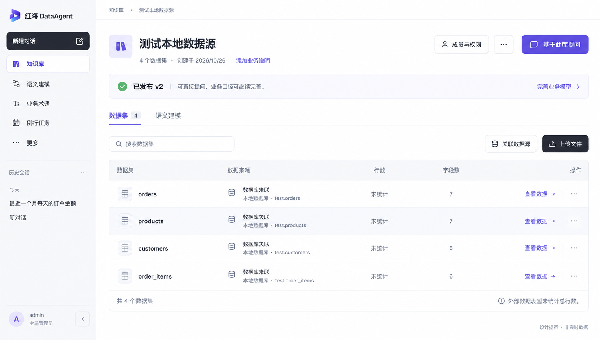

# 数据集工作台设计提案

2026-11-01，用户已认可，正式 DatasetGroupPage 和生产静态包已实施。图稿仍作为设计依据；实际验收见 [实施报告](../../test-reports/20261101-dataset-workspace-ui.md)。

## 设计范围
- 保留已认可品牌、侧栏、现有知识库和数据集信息架构。
- 页头保留成员与权限和主要提问操作；编辑信息、事实表时间范围收进更多菜单。空说明可由管理用户点击补充。
- 模型提示压缩为一条状态带；图中已发布 v2 是用户截图场景，不推断其他知识库已发布。准备中、未发布等状态仍须按 workflow/readiness 表达，准备时提问保持禁用。
- 数据集/语义建模页签保留，搜索及关联/上传入口集中在表格工具栏。
- 数据来源类型与文件/表路径合并为两行，避免表头“来源文件”用于外部表时含义不准。
- 约 76–80px 数据行、轻分隔线，名称和来源左对齐，行数/字段数居中；查看入口直接可见，删除留在更多菜单并保留确认。
- 外部表未知总行数仍为“未统计”，不展示虚构数量；图中提示仅适用于当前全外部表场景。上传/派生场景应显示真实来源和已有统计。
- QUERY 用户不显示管理菜单、上传、关联、成员管理、说明编辑或建模写操作；原服务端权限保持。

## 代码核对与后续约束
已核对 DatasetGroupPage 的现有动作、上传阶段和数据字段。该图重组已有能力，没有新增同步监测、自动计数、跨库混用或后台任务能力。

截图中来源标签过大有明确代码原因：knowledge-workspace.css 的 .kw-source 同时用于表格标签和空库导入卡片，后定义的卡片规则覆盖标签。正式页面现使用独立 dw-source，空库上传/关联卡片保留。

本图使用 built-in image_gen 生成，已通过 view_image 核对名称、四行数据、字段数 7/7/8/6、未统计及操作层级。图为视觉提案，不是浏览器运行截图；生成图中的微小字体、间距、图标细节以获准后的代码原生实现和实际浏览器验收为准。

完整提示词见 [prompt.md](prompt.md)。提案阶段未改代码，后续获准实施的编译、交互与视觉验收记录见实施报告。
