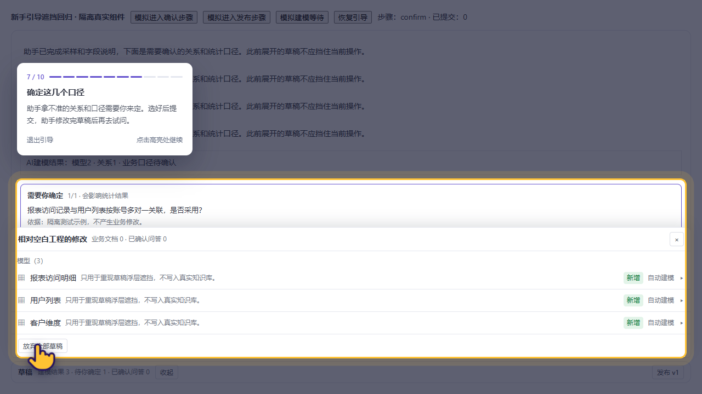
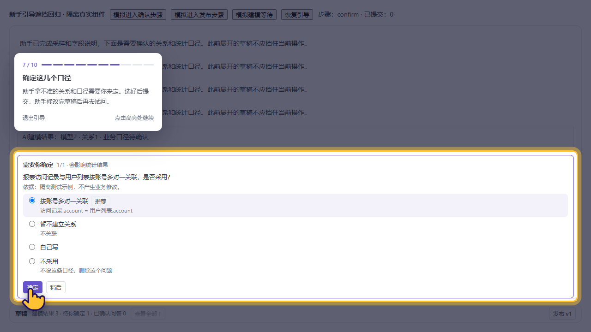

# 新手引导被草稿浮层遮挡修复

日期：2026-11-02 Asia/Shanghai。分支liyufan_dev，HEAD 0e9f25ee。未提交、推送或部署。

## 问题与修改

用户截图中的上传路线7/10“确定这几个口径”对应内部confirm步骤。DraftBar的绝对定位浮层可覆盖确认卡片，GuidedTour只根据原目标矩形测量，不知道该区域已被其他内容遮挡；结果高亮框和小手指向浮层内容，真正的确定按钮不可点击。

`tourLocksDraftDrawer`按当前tour的账号快照、知识库、未暂停状态及建模点击步骤判断。DraftBar订阅真实tour，在进入这些步骤时同步隐藏浮层并清理展开状态，禁用重开入口；只清理浮层内“放弃”二次提示，不清除发布前的待确认/他人修改提示。不调高z-index、不复制按钮、不自动确认/提交/发布。

等待步骤仍允许查看草稿；退出后可展开，恢复到未完成点击步骤会再次收起。其他知识库和术语页不受此锁影响。MySQL5.7已有修改全部保留，按用户要求暂不继续处理。

## 本轮验证

- npm test：67项× `/`、`/dataagent/`、`/dify/dataagent/` 三base通过。新增测试覆盖真实tour信号推进、暂停期间信号不推进、恢复同一步，以及不同账号/知识库隔离。
- TypeScript检查及生产前缀build通过；产物index-CWMytUr8.js、ontology-BEAl0AAh.js，CSS沿用index-DFxa2lLP.css。保留既有ECharts导入及大包提示。
- Playwright CLI加载当前真实GuidedTour、DraftBar、ConfirmationCards；以HEAD版DraftBar作为修复前对照，能重现相同遮挡。浏览器API均为隔离合成fixture，未连接5173/8080或写用户业务数据。
- 桌面1280×720：等待时展开→进入确认收起；不能重开；无自动提交；退出后可开；恢复后再收起；elementFromPoint命中实际“确定”按钮；用户真实点击推进试问；业务编辑/放弃/发布请求为零。
- 390×844：退出状态先展开，恢复确认引导后收起，按钮能点、小手完整位于视口内、无横向溢出，实际点击推进。首轮脚本在窄屏等待状态尝试点击被状态卡盖住的测试入口，改用正常退出/恢复路径完成此项，没有强制点击；不宣称测试了所有等待态布局。
- 1180×680真实iframe（1440×900模拟BI外壳）：浮层收起、确认按钮命中，发布前待确认提示保留，隐藏“跳过并发布”，“去处理”后能正常确认；未自动发布。初轮脚本选错顶层frame后已修正为iframe，本项重新通过。
- 修复后页面无JS错误；React Router既有future flag提示保留。修复前fixture的favicon 404与产品代码无关。

## 截图

| 修复前 | 修复后 |
|---|---|
|  |  |

[窄屏](assets/tour-drawer-20261102/tour-drawer-mobile.png) · [iframe](assets/tour-drawer-20261102/tour-drawer-iframe.png)

## 边界与手动回归

本轮验证的是实际组件的隔离UI行为，不是66线上BI或真实LLM全流程验收。仅解决草稿浮层遮挡这些建模步骤，不跳过真实确认/网络等待，不承诺任意其他弹窗都已处理。

本地Vite刷新后，在助手等待时展开草稿，再进入“确定这几个口径”，应自动收起且查看入口暂不可用；选择口径并点击确定后进入下一步。退出引导后能查看草稿，恢复引导再次收起。草稿内容保持，助手仍按用户实际选择修改。

独立浏览器/服务收尾与最终文档检查见SESSION_LOG；用户原服务和5.7测试容器保留。
