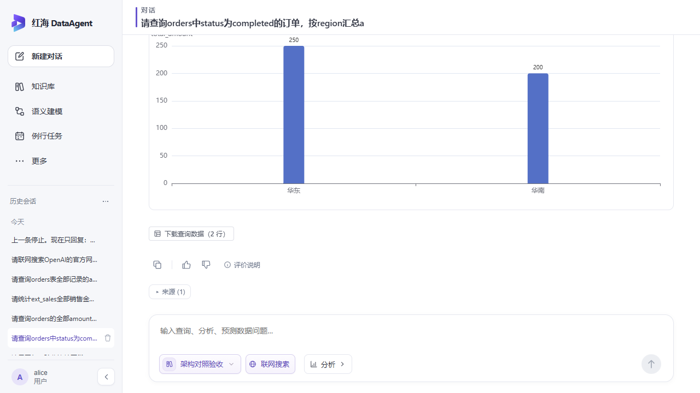

# 当前分支与liyufan_dev真实运行验收（2026-11-13）

## 结论

本轮实际启动两套应用，使用真实模型、MySQL、Wren CLI/MCP、Docker Python沙箱和浏览器验收。已测核心链路的业务数值、权限、状态流转与持久化行为一致，未发现架构改造分支独有的功能回归。不能据此宣布全部产品功能均正常：双方都有16个页面依赖接口404，例行任务均明确禁用；外部BI/企业IM/邮件等未做真实第三方交付。

当前分支codex/architecture-phase1@bb02f96d；对照分支liyufan_dev@5479d152。二者的预期故障恢复改进不要求退回旧行为，正常操作对照与恢复能力应分开判断。没有改业务代码，没有切换用户工作区分支、push、合并或部署；本轮报告和共享记录保留为待提交文件。

## 运行条件与隔离

- 从git archive提取个人分支源码，Java17打包为真实可执行JAR；当前JAR来自前一批已冻结源码的完整构建，952个非文档源码/测试/构建文件仍逐字节匹配。
- 两包的202个运行依赖JAR逐字节相同。前端生产源码/锁文件无差异，因此基线复用同一静态构建产物；最终两个运行JAR内9个前端资源文件逐字节相同。没有将mock网页、替身模型、内存仓库当作真实功能结果。
- 本机Docker desktop-linux/npipe daemon29.1.3，任务专用mysql:8.4.5、loopback随机端口、tmpfs数据；每边独立平台库/上传库/工作区/MDL/附件/用户沙箱。外部关联测试共用另一张只读合成表，不接触业务数据。
- 实际实例地址为127.0.0.1:62427（个人分支）与62428（当前分支）；验证后均已停止。只删除核实标签的本批MySQL与两只沙箱容器，四个浏览器会话已关闭，未停止既有用户服务或其他容器。

## IDEA为什么能够使用模型

IDEA选中的是Spring Boot.DataAgentApp(1)，激活dev profile，并设置DEEPSEEK_API_KEY等环境变量。dev文件里的默认OpenAI连接探测402、备用DashScope连接401，并不代表实际应用使用这两条连接。

平台数据库保存并激活的模型服务会覆盖启动默认连接。已用只读事务SELECT读取这条活动配置，在内存解密后仅将活动连接重新加密到临时库；原数据库/主密钥未修改，未输出API密钥。活动模型为qwen/deepseek-v4.1-flash-1017，双方都通过实际连接及工具调用测试。后续重启还复用了选中IDEA配置的搜索环境变量，两边实际web_search成功。

本轮保持相同的活动模型参数，不强行把温度改成0。答案措辞、工具调用ID、问题ID及CSV列布局存在生成差异；以业务结果、工具实际执行和访问边界判断等价，不要求逐字相同。未使用业务库数据做破坏性验收，未连接真实BI或发送邮件/企业消息。

## 功能覆盖与实测

| 环节 | 实际操作与断言 | 个人分支 / 当前分支 |
| --- | --- | --- |
| 启动/认证 | 真实MySQL validate启动；健康检查、错误密码/未登录401、三个种子账号登录、普通用户访问模型管理403 | 一致通过 |
| 接口完整性 | Actuator实取250条映射（246条/api），比较全部requestMappingConditions：路径/方法/参数条件/请求及响应类型 | 完全一致，内部handler类归属不作为HTTP差异 |
| 前端与页面 | 每边21个普通页面及15个管理员页面；角色不足的编辑页按原规则跳转；未捕获JS异常0 | 一致；404另列，不能将无JS异常等同于页面功能完整 |
| 普通对话 | 真实模型流式回复“验收连接正常”，capacity/scope/token/done协议 | 一致通过 |
| 创建/上传/预览 | 建知识库、上传同一UTF-8 CSV，4行，保留001等编号；HTTP预览与实际MySQL表 | 一致通过 |
| Wren校验与发布 | 官方CLI校验、编译、预览/结构视图/草稿读取、显式发布成功 | 一致通过 |
| 共享与撤权 | bob无权访问；授QUERY可浏览和预览，不能发布；撤权后拒绝 | 一致通过 |
| 问数 | 通过实际MCP run_sql执行SELECT SUM(amount),COUNT(*) FROM orders；核对回执与SQL返回，不只看回答文字 | 总额500，4条；业务SQL相同 |
| 图表 | completed订单按区域汇总，真实run_sql→render_chart→私有图表API→历史页面ECharts canvas | 华东250、华南200；跨用户404；两张截图字节相同 |
| Python/附件 | 真实run_python执行，生成并HTTP下载CSV，不以模型心算替代；他人不可下载 | 平均125，合计500，4条；CSV内容布局不同，数值一致 |
| 建模 | 确认字段，真实modeling-agent修改amount说明；读取草稿差异、保留待发布状态，再显式发布 | 均写入“订单金额（元）”，未自动发布 |
| 问题试问 | 创建问题文件、官方dry-plan；页面试运行、人工确认、再次发布到版本3 | 修正生成格式后均通过，首次格式问题见下文 |
| 答案反馈/记忆 | 读取真实会话、UP并检查SAVED与1个SQL样例、读取反馈状态、DOWN | 一致通过 |
| 外部数据源 | 只读账号连接检测/库表列枚举、关联表、刷新采样、确认FACT并设置LIMITED 7天 | 一致通过 |
| 时间门禁 | 不给日期时追问；给2026-11-10至11-11后实际查询 | 均返回50，2条 |
| 工作区/Agent | 新建自有Agent、他人不可见；私有记忆文件写入/读取/改名/删除，删除Agent | 一致通过；内置Agent不可编辑是双方既有权限 |
| 辅助入口读取 | 每边63次扩展HTTP检查，包括Agent/工作区/工具与技能目录、模板、通道、个人及管理员列表 | 每边51×200、1×201、3×204、4×400、2×403、2×404；400为缺必要参数等负向检查，不冒充完整正向用例 |
| 贡献审批 | 合成共享记忆提交、非管理员审批入口403、管理员批准APPROVED、我的贡献列表 | 一致通过，未向外部人员发通知 |
| 模型管理 | 真实新增/测试/激活临时连接；普通用户403、禁止删除活动连接、过期revision409、修改待应用、恢复原连接并删除临时连接 | 一致通过；实际仍使用同一模型服务 |
| 会话/历史 | 读取真实历史及knowledgeScope，他人403；标为已读；重置清空；删除会话后附件404 | 一致通过；模型产生中间消息数量不同不判为协议差异 |
| 应用重启 | 终止本批进程后同端口/持久目录启动；历史、模型配置、原会话、附件再读取；基于之前结果继续回答 | 均恢复500与4，无需重新查询 |
| 联网搜索 | 按IDEA环境启用，实际web_search查询公开官网，返回来源链接 | 均得到OpenAI官网https://openai.com |
| 取消/继续 | 首token后关闭SSE；再发新轮并检查最终done | 均可恢复；首次立即重发曾都返回“正在停止”，释放后通过 |
| 单数据集删除 | 元数据删除后用真实information_schema核对上传表消失 | 一致通过；本次为正常删除，不替代前批故障恢复矩阵 |
| 外部关联删除 | 删除关联数据集后直接核对外部原表 | 两边都保留2条/50元，未drop外部表 |
| 整库删除 | 清理目录，关闭Wren；数据库行与目录都不存在；已删除资源拒绝访问 | 一致通过，tombstone期间GET为409，重删404 |
| 例行任务 | 查看安全配置与实际请求 | 两边均denyAll/403，未执行调度与邮件 |

图表历史页的同一可见区域截图：

两张截图SHA-256均为520606f649c3b2d50bdbdade66b3b9ac48ff7c39c0bcbc4ac7298ed4e66e49ec。它只证明这次截图对应区域，不代表所有页面像素或所有生成答案相同。

[全部250条运行映射明细](20261113-branch-runtime-route-contracts.tsv)，条件签名：f98eac7afd90b8493437817913a6839fbe7af53bcfb90f1e89fcfe7f50a3d22c。主流程原始SSE、HTTP结果、运行日志、浏览器结果、SQL断言、截图与清理记录保留在忽略目录.runtime/accept134；不把其中的模型配置或临时凭证放入版本控制。

## 双方共同存在的缺口

以下16个页面请求在两边均404，且本轮运行映射中没有对应接口。页面可以打开，不代表这些数据面板可用；这不是本次架构分支新增的差异。本轮未将补齐这些旧接口纳入修复，以免改变对照基线。

- `/api/admin/agents`
- `/api/admin/config/agentscope`
- `/api/admin/debug/info`
- `/api/admin/runtime/channels`
- `/api/admin/runtime/instances`
- `/api/admin/runtime/logs`
- `/api/admin/runtime/overview`
- `/api/admin/runtime/sessions`
- `/api/admin/sessions`
- `/api/admin/usage/daily`
- `/api/admin/usage/hourly`
- `/api/admin/usage/summary`
- `/api/admin/usage/top-agents`
- `/api/admin/usage/top-users`
- `/api/usage/me/daily`
- `/api/usage/me/summary`

另有两项应区分：例行任务已被SecurityConfig显式禁用，不能宣称调度执行已验收；KG/本体旧链维持停用/空态，不恢复旧查询链。以上“行为一致”不等于“功能完整”。

## 验收过程中的纠正与限制

自然语言提交试问时，双方模型首次把definition写成YAML数组，虽然SQL正确，平台仍拒绝试运行（400）。通过建模对话明确definition须为多行字符串后，实际试运行、人工确认及发布均成功。这里说明需要格式约束/人工修正，不能报告为首轮全自动成功，也不能把这次观测当作模型质量统计。

验收脚本起初误把内置Agent视为可编辑、任务视为可写、已删知识库视为必定404；核对源码及两边相同响应后，改用自有Agent并按禁用/墓碑契约检查。删除脚本的首次停止发生在已经成功删除资源后的GET 409断言；后续核对真实表/数据库行/目录并继续会话清理，不将重试404混为删除失败。第一次依赖检查也因源码脚本不处于发布布局失败，复制到正确隔离布局后真实Wren依赖通过。

未验证真实BI票据/人员目录同步、第三方IM或邮件实际送达、远端市场Git/Nacos服务、多浏览器/移动端全组合、生产数据量/旧内核/真实网络故障和所有可能输入。路径/所有HTTP分支穷举、覆盖率、长时间稳定性和性能压测也不在本次结论内。本批没有重做断电/磁盘灾难/多实例恢复；前批子JVM故障与事务验收仍按原报告的证据范围引用。

## 交付与后续

本轮没有业务源码修复，因为未发现对照中新引入的确定性回归；报告及共享记忆待提交。文档一致性5项通过、68条本批文档相对链接有效，952个非文档源码冻结核对完成；没有以重新运行旧1129项代替真实功能验收。建议后续单独处理双方共有的管理/用量接口缺口；若要启用例行任务，应先明确产品和权限设计，再实施执行与通知链路。
